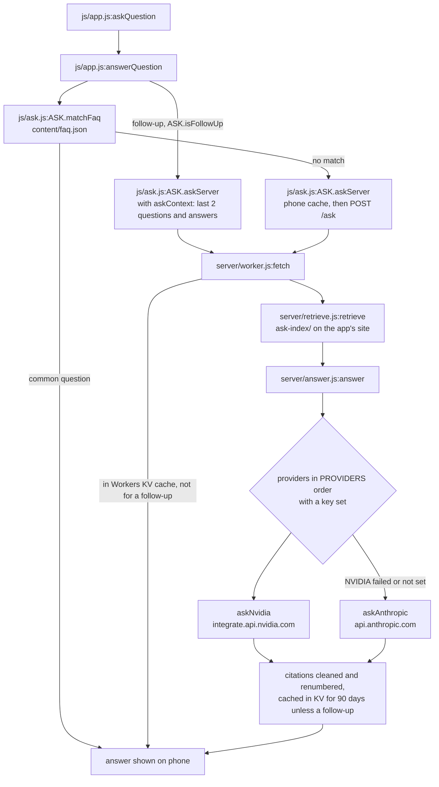

# How the code runs

Swadhyay has two parts: the **app** (static files served by GitHub Pages, plain JavaScript, no
build step) and the **Ask server** (a Cloudflare Worker in `server/`).

## Entry points

| Entry point | Started by |
|---|---|
| `index.html` → `js/app.js` (the IIFE, ending in `render()`) | Opening the site; scripts load in the order listed in `index.html` |
| `sw.js` | Registered by `js/app.js` (`navigator.serviceWorker.register('sw.js')`); caches the app for offline use |
| `server/worker.js` → `fetch(request, env)` | Cloudflare, on each HTTP request (`npx wrangler deploy`) |
| `tools/serve_ask.mjs` | `node tools/serve_ask.mjs`: runs the Worker locally on port 8787 |
| `tools/test_ask.mjs` | `node tools/test_ask.mjs "question"`: retrieval (and the model, if a key is set) from the command line |
| `tools/build_ask_index.js` | `node tools/build_ask_index.js`: builds `ask-index/` and links `content/faq.json` to verses |

## Order of execution (app)

1. `index.html` loads `js/strings.js`, the icon, drawing and helper scripts, `js/askkey.js`,
   `js/ask.js` (defines `ASK`), then `js/app.js`.
2. `js/app.js` reads saved settings (`loadState()`), wires up events (`hashchange` → `render`,
   keys, swipes, scroll) and calls `render()`.
3. `render()` → `routeParts()` reads the address after `#` (e.g. `#/read/bhaktamar/12`) and draws
   that screen; `getCatalog()` fetches `content/books.json` and related JSON on first use. On every
   screen but the reader and the welcome, `navBar()` is put first in `#app`, ahead of the screen.
   `css/app.css` places it: at the foot of the screen on phones and tablets, as a sticky bar across
   the top from a 1024px viewport.
4. `afterRender()` → `syncChrome()` measures the bars into `--top-h`, `--bar-h` and `--composer-h`
   (`bottomBar()` and `tabsOnTop()` say where the tabs stand), then `fitVerses()`,
   `updateScrollCue()` and `updateScrollmark()`.
5. `sw.js` is registered and caches the app files (named by `VERSION`).

## Main flows

**Reading a text:** `#/read/<book>/<n>` → `js/app.js:render()` → `viewRead()` → book JSON from
`content/` → verse screen; swipe or arrow keys → `readerStep()`. Scripture in a shrine is drawn as
`.read-pair` → `.sanctum` (shrine, plinth, attribution) and `.notes` (`commentaryHtml()` and the
sung recording), which `css/app.css` sets side by side when `main.reader` is at least 52rem wide.

**Reciting a pooja** (texts with `scroll: true`, stories excepted): a list row's link comes from
`bookHref()` (`#/read/<book>/<saved stanza>`), so `render()` → `viewRead()` opens it directly.
`viewRead()` → `offeringOf()` per stanza → the offering words; `linesHtml()` sets `MANTRA_RE`
lines apart; `readerBack()` points the back link at the list (`bookParent()`). After drawing,
`afterRender()` scrolls to the saved stanza (`stuckHeight()`), then `trackPlace()` and
`keepAwake()`. While reading, the `scroll` listener → `trackPlace()` saves the stanza to
`state.positions`; `visibilitychange` → `keepAwake()` asks for the wake lock again.

**Showing the meaning:** `viewRead()` → `commentaryHtml(book, v, 'meaning')` per verse (and
`'rest'` for what always shows) → the shrine's `.notes` or each verse's `.verse-pair`, hidden by
CSS until `main.reader` has `.show-meaning`. The "Show meaning" button → action `meaning` →
`keepPlace()` toggles the class and saves `state.meaning`; `speakPage()` reads the meaning only while
it shows. "गायन सुनें" → action `rec-open` → shows `#rec-panel` (`recordingHtml()`).

**Home:** `#/` → `render()` → `viewHome()` → `.home-start` (greeting, `readingHtml()`),
`.home-paths` (`pathsHtml()`), `.home-day` (`todayHtml()`, `festivalCardHtml()`), `.home-story`,
`.home-sutra`. One column on phones; a grid of start and day, library, story and sutra on wide
screens.

**Asking a question** (Ask screen):

As a call chain: `js/app.js:askQuestion()` → `js/app.js:answerQuestion()` →
`js/ask.js:matchFaq()` → (no match) `js/ask.js:askServer()` → `server/worker.js:fetch()` →
`server/retrieve.js:retrieve()` → `server/answer.js:answer()` → `askNvidia()`, then
`askAnthropic()` if NVIDIA fails.

A follow-up ("why?", "and his wife?"): `js/app.js:answerQuestion()` → `js/ask.js:isFollowUp()` →
`js/app.js:askContext()` (the last two questions and answers) → `js/ask.js:askServer(question,
lang, context)` (no phone cache) → `server/worker.js:fetch()` with `history` (no KV cache;
searched as this question plus the one before) → `server/answer.js:answer(..., history)` →
`earlierTurns()` puts the conversation before the question for either model.

**Server health:** `GET /health` → `server/worker.js:fetch()` → `server/answer.js:primaryModel()`
and `providers()` (reports which model answers first and which providers have keys).

**Rebuilding the search index:** `node tools/build_ask_index.js` → reads `content/` →
writes `ask-index/` and updates `content/faq.json` (uses `js/askkey.js` for word matching).

## Key modules

- `js/app.js`: the whole app UI: settings, routing, screens, reader, recordings, Ask screen.
- `css/app.css`: the whole look: tokens for day and night, the phone layout, then the wide-screen layout
  (`@media (min-width: 1024px)` and container queries) and the opening darshan.
- `js/ask.js`: Ask logic on the phone: common questions, local answer history, call to the server.
- `js/askkey.js`: word matching shared by the app, the server and the index builder.
- `js/strings.js`: all interface text in Hindi and English.
- `sw.js`: offline cache of the app.
- `server/worker.js`: the Ask server: CORS, rate limit, KV cache, `/ask` and `/health`.
- `server/retrieve.js`: finds the best passages in `ask-index/` for a question.
- `server/answer.js`: model instructions and the calls to NVIDIA and Anthropic, with fallback.
- `server/wrangler.toml`: Worker settings: models, provider order, index address, origins, KV.
- `tools/serve_ask.mjs`, `tools/test_ask.mjs`: run and test the Ask server locally.
